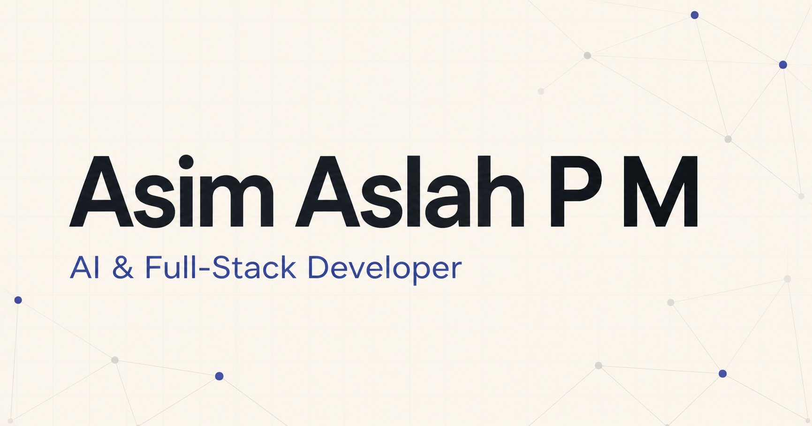

# Asim Aslah — Portfolio

Professional portfolio for **Asim Aslah P M**, an AI evaluation engineer, AI/ML and Generative AI developer, AI researcher, and full-stack software engineer building explainable evaluation systems, privacy-preserving AI, and deployed web applications.

[View the live portfolio](https://asim-portfolio.asimaslu7.workers.dev/)



## Highlights

- Dedicated case studies for EvalLens and AI Quality Lab, covering human-centered comparative evaluation and observable automated evaluation
- Authentic EvalLens product screenshots, verified v1.0.0 release evidence, and an honest implementation-complete status for AI Quality Lab
- Responsive project case studies for Image-to-3D, DataVeil, Shopify Fashion Storefront, and AI Virtual Keyboard
- Ongoing PIIShift-RAG M.Tech research presented separately from implemented and validated project work
- Large interactive BYTE portfolio guide in the hero, with verified, scripted answers and recruiter-focused shortcuts
- Interactive Mini Byte hero companion with theme switching and reduced-motion support
- Light and dark themes, optional interface sound, keyboard navigation, and responsive layouts
- Persistent portfolio ratings backed by Cloudflare D1
- SEO metadata, Open Graph imagery, sitemap, robots metadata, and accessible interaction states

## BYTE portfolio guide

The hero includes a large interactive **BYTE** guide that opens the portfolio assistant. Visitors can use its suggested questions or type their own question to explore verified information about Asim's projects, experience, skills, education, résumé, and contact details. BYTE is scripted entirely from the portfolio's maintained content and does not send questions to a live AI service.

BYTE understands both evaluation projects, how their methodologies differ, Asim's project-based AI evaluation experience, and the latest-project order. Large BYTE remains separate from **Mini Byte**, the smaller character that moves across the letters in Asim's name and provides the playful theme-switching interaction.

## Technology

- React 19, Next.js 16, TypeScript, and vinext
- Vite and Tailwind CSS
- Cloudflare Workers, Assets, and D1
- Drizzle ORM
- Node.js test runner and ESLint
- Vitest and Playwright as demonstrated project-quality skills

## Local development

Requirements:

- Node.js 22.13 or newer
- pnpm

```bash
pnpm install
pnpm dev
```

Open [http://localhost:3000](http://localhost:3000).

The portfolio pages run locally without additional secrets. The feedback API requires the Cloudflare D1 `DB` binding; without it, the local feedback section displays its unavailable state while the rest of the portfolio remains functional.

## Optional environment variable

Copy `.env.example` to `.env.local` when enabling Cloudflare Web Analytics:

```env
NEXT_PUBLIC_CLOUDFLARE_WEB_ANALYTICS_TOKEN=
```

Leave the value empty when analytics is not configured. Never commit real environment values.

## Commands

| Command | Purpose |
| --- | --- |
| `pnpm dev` | Start the local development server |
| `pnpm lint` | Run ESLint |
| `pnpm test` | Run the automated test suite |
| `pnpm build` | Create the production build |
| `pnpm start` | Start the built application locally |
| `pnpm db:generate` | Generate Drizzle database artifacts |

## Deployment

The production application is deployed as the `asim-portfolio` Cloudflare Worker. Its asset and D1 bindings are defined in `wrangler.jsonc`.

```bash
pnpm build
pnpm exec wrangler deploy
```

Deployment remains a post-review step. Feature work is validated on its branch and merged before the existing Cloudflare Worker is updated; no D1 migration or secret change is required for the AI evaluation portfolio content.

## Project structure

```text
app/          Routes, metadata, styles, and feedback API
components/   Portfolio interface and interactive components
data/         Verified profile and project content
db/           D1 schema and feedback persistence
drizzle/      Database migration artifacts
lib/          BYTE, feedback, theme, and Mini Byte logic
public/       Images, video, résumé, and social preview assets
tests/        BYTE, feedback, and Mini Byte tests
```

## Contact

- [GitHub](https://github.com/AsimAslah)
- [LinkedIn](https://www.linkedin.com/in/asim-aslah-pm-05906a222)
- [Email](mailto:asimaslu7@gmail.com)
